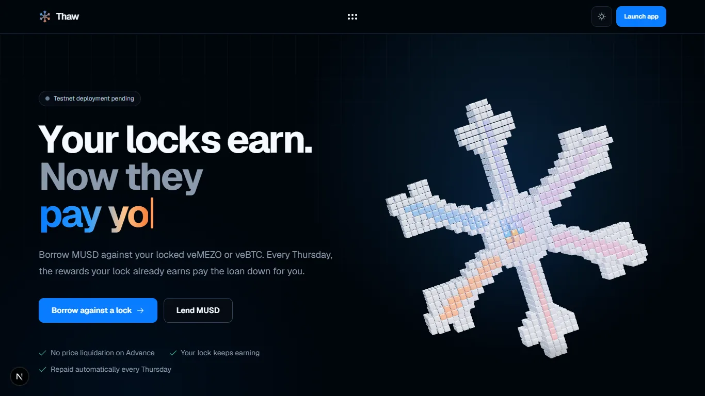
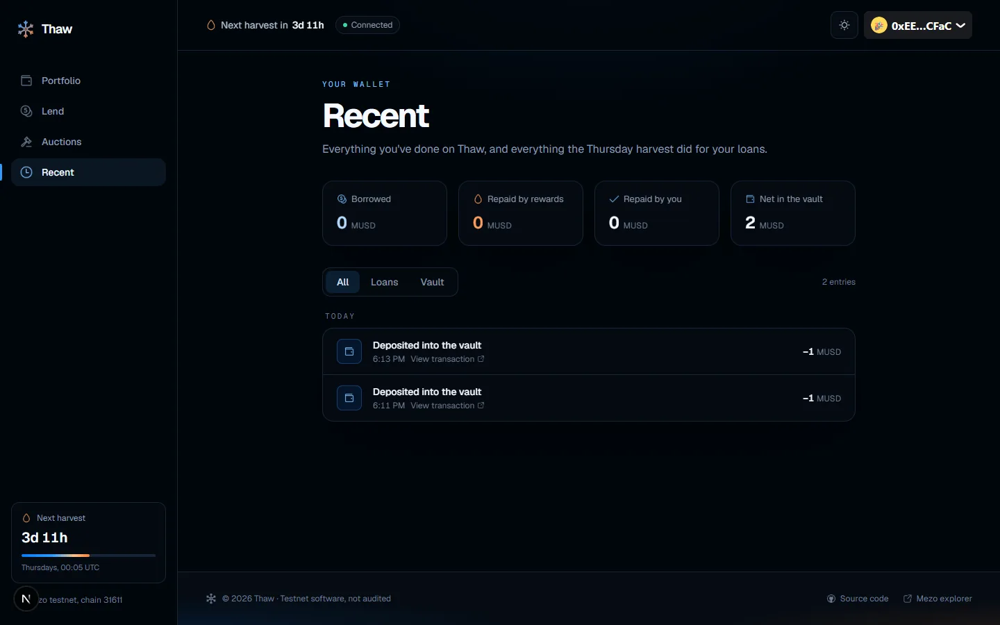
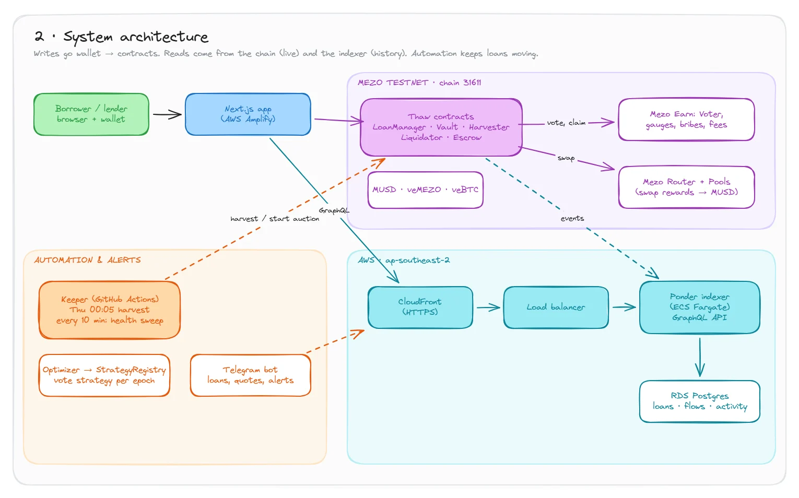
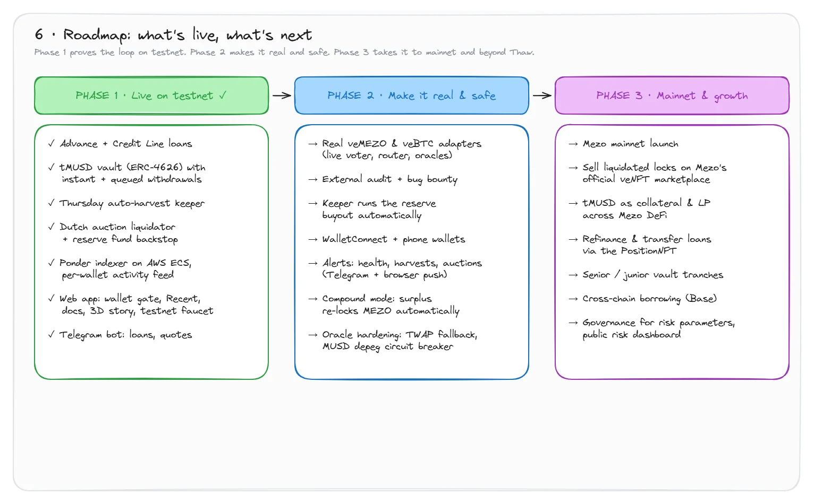

<div align="center">

# Thaw

**Your locks earn. Now they lend.**

Borrow MUSD against a locked veMEZO or veBTC position, and let the rewards it already earns pay the loan back, every Thursday, automatically.

[**Open the app**](https://main.d3vf8kr22dusli.amplifyapp.com) · [Docs](https://main.d3vf8kr22dusli.amplifyapp.com/docs) · [System design](docs/THAW_SYSTEM_DESIGN.md)

Live on Mezo testnet (chain 31611) · Built for the [Mezo Buildathon](https://app.akindo.io/wave-hacks)



</div>

---

## The problem

Locking MEZO or BTC on Mezo earns weekly rewards, but the position itself is frozen for months or years. You can't sell it, and today you can't borrow against it either. The value just sits there.

## What Thaw does

Thaw turns a locked position into MUSD you can spend today, and repays itself out of the rewards that position was going to earn anyway.

1. **Deposit your lock.** Your veNFT goes into Thaw's escrow. You stay the owner on record, and it keeps voting and earning.
2. **Borrow MUSD.** It lands in your wallet in the same transaction.
3. **Thursdays pay it down.** At 00:05 UTC each epoch, a permissionless keeper votes your lock, claims its bribes and fees, swaps them to MUSD and repays your loan.
4. **Take your lock back.** When the debt hits zero, withdraw your veNFT: still locked, still earning, never sold.

## Two ways to borrow

|                      | **Advance**                       | **Credit Line**                    |
| -------------------- | --------------------------------- | ---------------------------------- |
| Sized by             | Your lock's weekly rewards        | Your lock's discounted value       |
| How much             | About 10 weeks of counted rewards | 25% (veMEZO) to 60% (veBTC) of value |
| Interest             | Fixed, 5–6% APR                   | Fixed, 5–6% APR                    |
| If rewards drop      | The loan just takes longer        | Health factor falls                |
| Price liquidation    | **Never**                         | Dutch auction below health 1.0     |

**Example:** a lock earning 60 MUSD a week can take a 450 MUSD Advance today and is paid off in about 11 Thursdays, with nothing out of pocket.

## For lenders

Deposit MUSD into **tMUSD**, an ERC-4626 vault, and earn from three places at once:

- **Loan interest** at a fixed APR
- **A share of every Thursday harvest**
- **The MUSD Savings Rate** on anything not lent out

Withdrawals are instant up to idle liquidity. Anything beyond that queues and fills from the next harvest, since every loan pays down weekly.

## When things go wrong

A Credit Line whose health factor falls below 1.0 can be sent to auction by anyone. The lock is sold in a **24-hour Dutch auction** that starts at 95% of its value and falls to a floor that covers the debt. Proceeds repay the vault first, 2% goes to the reserve fund, and the rest goes back to the borrower. If nobody bids, the reserve fund buys at the floor. An Advance is only looked at after 8 Thursdays with no repayment.

## The app

- **Portfolio:** your locks, what each can borrow, and your open loans. A testnet faucet hands out 1,000 test MUSD and a demo lock.
- **Loan page:** debt, health, a debt-over-time chart, every harvest, and optional early repayment.
- **Lend:** deposit and withdraw, with your position and earnings.
- **Auctions:** live and settled auctions, with a live price.
- **Recent:** everything your wallet did, plus every harvest on your loans, with explorer links.
- **Docs:** how it works, the risks, and every contract and parameter read live from the chain.



## Try it in two minutes

1. Add **Mezo Testnet** to your wallet: chain ID `31611`, RPC `https://rpc.test.mezo.org`, currency `BTC`.
2. Get a little testnet BTC for gas.
3. Open the [app](https://main.d3vf8kr22dusli.amplifyapp.com), click **Launch app** and connect.
4. On **Portfolio**, use the faucet to get test MUSD and a demo lock, then **Borrow** against it.
5. Try **Lend**, repay part of your loan, and watch it all appear under **Recent**.

## Try the Telegram bot

Linking is verified, so nobody can attach a wallet they don't own to their chat:

1. Send `/connect` to **@thaww08_bot** (or tap **Get alerts on Telegram** in the app). The bot replies with a
   one-time code and a button.
2. Tap the button. It opens the app, where you sign a short message with your wallet. The signature is
   free: no transaction, no gas.
3. The chat is linked. Send `/unlink` any time to stop.

| Send | You should get |
|---|---|
| `/start` | A welcome message listing the commands |
| `/connect` | A one-time code and a "Verify with your wallet" button |
| `/loans` | Your open loans with what each still owes (from the indexer) |
| `/quote <loanId>` | That loan's current debt and health factor (from the chain) |
| `/unlink` | Stops alerts for this chat |

It also messages you on its own: an **epoch report every Thursday at 07:00 UTC** after the harvest,
and a **warning every 15 minutes** if a linked loan's health gets close to liquidation.

## Live deployment

| Piece         | Where |
| ------------- | ----- |
| App           | AWS Amplify: <https://main.d3vf8kr22dusli.amplifyapp.com> |
| Indexer API   | AWS ECS behind CloudFront: <https://dsiqcqjcx7f6.cloudfront.net/graphql> |
| Keeper        | GitHub Actions: Thursday harvest, plus a 10-minute health sweep |
| Telegram bot  | AWS ECS (`thaw-bot`): commands, epoch reports and health warnings |
| Contracts     | Mezo testnet, addresses in [`deployments/mezo-testnet.json`](deployments/mezo-testnet.json) |

Key contracts: LoanManager `0xfDd14a3be9A3D8ca2c9e24b7E41F8406EA5D3ac3` · tMUSD vault `0x59DFe06919e1d9D2F9d1d35D2Eb1d5E5d01785C8` · Harvester `0xcB506EE67dc7968507adcF69D84e1BA8Aadb64b8` · Liquidator `0xF7D8AF14Ff39Ae2e27C945327cb04Eb9Dbb99BA0`

## How it's built



The full [system design](docs/THAW_SYSTEM_DESIGN.md) walks through user flows, architecture, contracts, the harvest, liquidation and the roadmap, each with a diagram.

```
contracts/           Foundry: LoanManager, ThawEscrow, RiskEngine, Harvester, TMUSDVault (ERC-4626),
                     DutchAuctionLiquidator, ReserveFund, PositionNFT, OracleRouter, StrategyRegistry,
                     adapters (veBTC, veMEZO, mock). See contracts/README.md
indexer/             Ponder: loans, harvests, vault flows, auctions and per-wallet activity over GraphQL
services/keeper/     Weekly harvest batching and the health-factor liquidation sweep (viem)
services/optimizer/  Vote-strategy allocator that posts to StrategyRegistry
apps/web/            Next.js app: wagmi + RainbowKit, GSAP motion, three.js scenes modelled in Blender
apps/bot/            Telegram bot: /connect, /loans, /quote, epoch reports, liquidation alerts
docs/                System design and README assets
```

**Mezo primitives used:** MUSD · MEZO · veMEZO · veBTC · Voter and gauges · bribe and fee rewards · Router and Pools · MUSD Savings Rate.

## Roadmap



**Phase 1: live on testnet ✓**
- Advance and Credit Line loans against veNFTs
- tMUSD vault (ERC-4626) with instant and queued withdrawals
- Thursday auto-harvest keeper and a 10-minute liquidation sweep
- Dutch auction liquidator with a reserve-fund backstop
- Indexer on AWS with a per-wallet activity feed
- Web app with wallet gate, Recent, docs and a testnet faucet; Telegram bot

**Phase 2: make it real and safe**
- Live veMEZO and veBTC adapters on Mezo's voter, router and oracles
- External audit and a bug bounty
- Keeper runs the reserve buyout automatically
- WalletConnect and phone wallets
- Alerts for health, harvests and auctions (Telegram and browser push)
- Compound mode: surplus rewards re-lock MEZO automatically
- Oracle hardening: TWAP fallback and an MUSD depeg circuit breaker

**Phase 3: mainnet and growth**
- Mezo mainnet launch
- Liquidated locks listed on Mezo's official veNFT marketplace
- tMUSD as collateral and liquidity across Mezo DeFi
- Refinancing and loan transfers through the PositionNFT
- Senior and junior vault tranches
- Cross-chain borrowing on Base
- Governance over risk parameters and a public risk dashboard

## Run it locally

```bash
# Contracts: build and test (Foundry, London EVM)
cd contracts && forge build && forge test

# Deploy (mock MUSD and MockVeAdapter when MUSD_ADDRESS / VEBTC_ADDRESS are unset)
forge script script/Deploy.s.sol --rpc-url mezo_testnet --broadcast

# App, indexer and services (each has its own .env.example)
cd apps/web && npm install && npm run dev
cd indexer && npm install && npm run dev
cd services/keeper && npm install && npm start
```

## Status

Thaw runs on **Mezo testnet with test funds only**. It has **not been audited**. The live deployment uses a mock veNFT adapter so anyone can try the full loop. The real veBTC and veMEZO adapters need live voter, router and oracle addresses passed to `script/Deploy.s.sol`.
