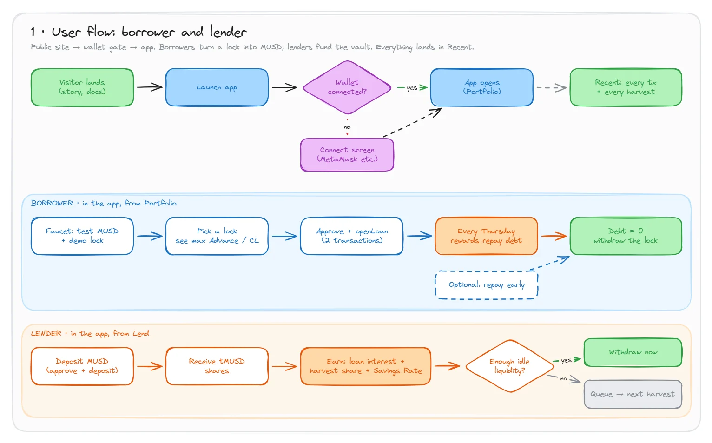
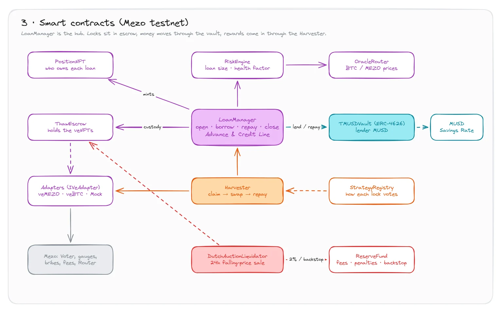
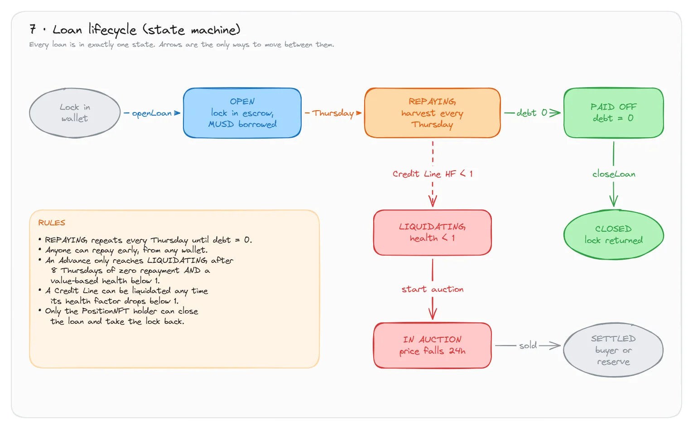
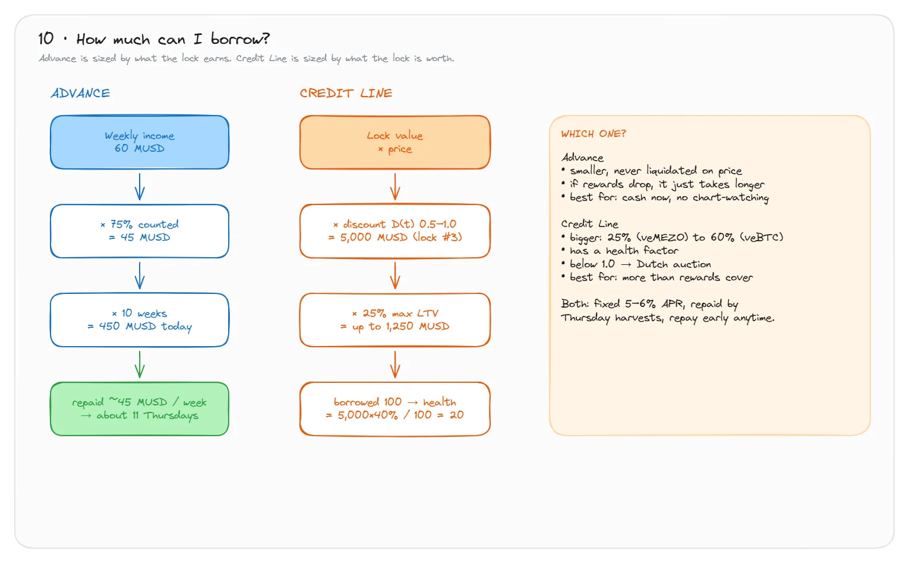
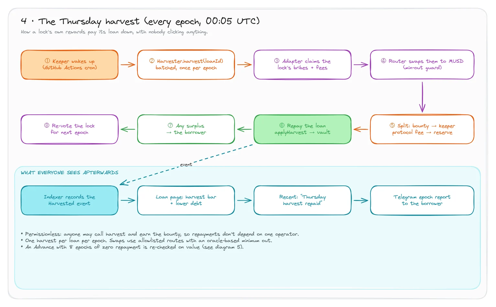
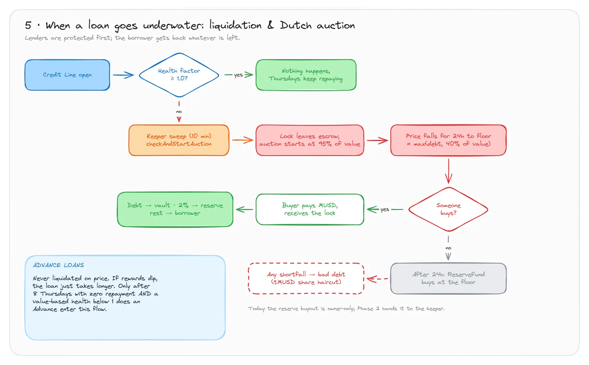
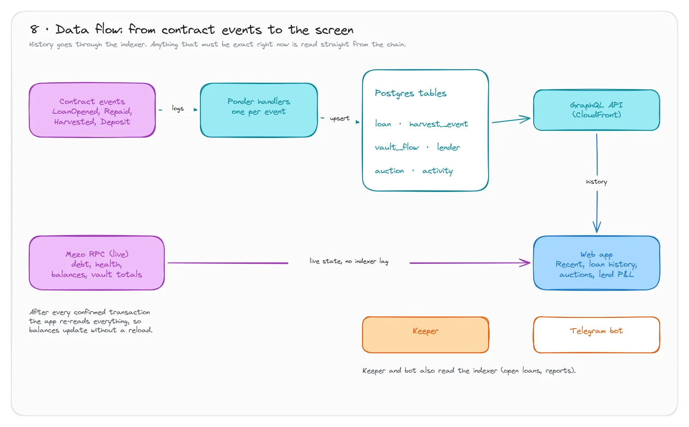
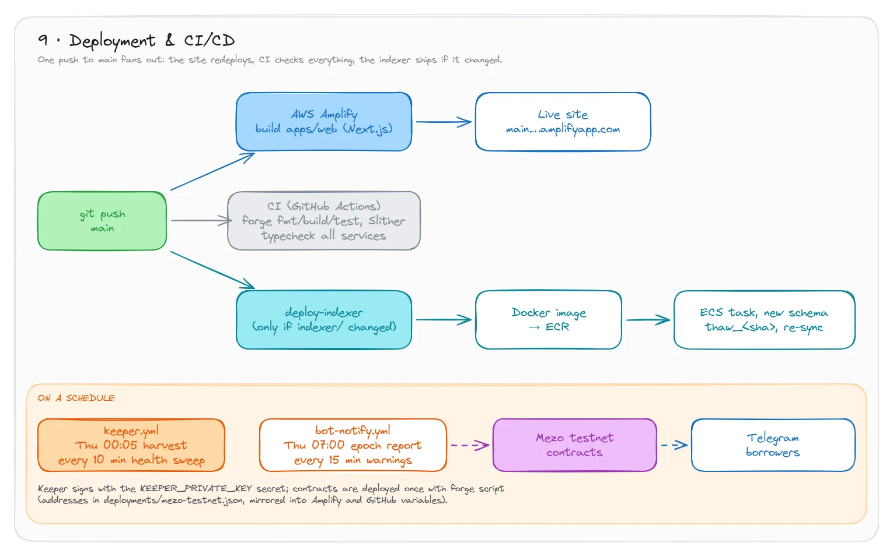

# Thaw: System Design

Self-repaying MUSD credit for locked Mezo positions. A borrower deposits a veMEZO or veBTC NFT, borrows MUSD against it, and the rewards the lock earns every Thursday repay the loan automatically. Lenders fund the loans through an ERC-4626 vault.

Diagrams are in [`thaw-system-design.excalidraw`](thaw-system-design.excalidraw) (open it at excalidraw.com to edit).

## Contents

1. [Goals and requirements](#1-goals-and-requirements)
2. [User flows](#2-user-flows)
3. [Architecture](#3-architecture)
4. [Mezo primitives](#4-mezo-primitives)
5. [Smart contracts](#5-smart-contracts)
6. [Loan math and risk engine](#6-loan-math-and-risk-engine)
7. [The Thursday harvest](#7-the-thursday-harvest)
8. [Liquidation and auctions](#8-liquidation-and-auctions)
9. [Lender vault (tMUSD)](#9-lender-vault-tmusd)
10. [Off-chain services](#10-off-chain-services)
11. [Deployment and infrastructure](#11-deployment-and-infrastructure)
12. [Security and threat model](#12-security-and-threat-model)
13. [Failure modes and operations](#13-failure-modes-and-operations)
14. [Testing](#14-testing)
15. [Roadmap](#15-roadmap)

---

## 1. Goals and requirements

**Problem.** A veMEZO lock can last up to 4 years and earns weekly rewards, but the position can't be sold or borrowed against. Holders who need liquidity have to avoid locking or sell, which weakens the ve flywheel.

**Functional requirements**
- Borrow MUSD against a veMEZO or veBTC NFT without giving up ownership on record.
- Two loan modes: an **Advance** sized by income that is never price-liquidated, and a **Credit Line** sized by value with a health factor.
- Repay automatically from the lock's own rewards once per epoch, with optional manual repayment at any time.
- Return the lock when the debt reaches zero.
- Let lenders deposit and withdraw MUSD and earn interest plus a share of harvests.
- Liquidate unhealthy Credit Lines through a public Dutch auction.
- Give every wallet a full history of its loans, repayments and vault activity.

**Non-functional requirements**
- **Permissionless automation:** anyone can run the harvest and the liquidation check, and is paid a bounty for it.
- **Isolation:** the core never imports a Mezo ABI directly; each ve system sits behind an adapter.
- **Bounded risk:** per-collateral debt ceilings, a reserve fund as first loss, and conservative LTVs.
- **London EVM:** Solidity 0.8.24 compiled with `evm_version = "london"` (no `PUSH0` on Mezo).
- **Honest UI:** a missing number shows "—" with a reason, never a guess.

**Out of scope for now:** mainnet, real veMEZO voting (the testnet deployment uses a mock adapter), cross-chain lending.

---

## 2. User flows



- **Gate:** the public site (landing, docs) needs no wallet. The app itself (Portfolio, Lend, Auctions, Recent) opens only with a connected wallet. This is a UX boundary, not access control, because every number is public on-chain.
- **Borrower:** pick a lock → see the maximum Advance and Credit Line → approve the escrow and open the loan (2 transactions) → MUSD arrives in the same transaction → Thursdays repay → withdraw the lock once the debt is zero. Early repayment is optional.
- **Lender:** approve and deposit MUSD (2 transactions) → receive tMUSD shares → earn → withdraw instantly up to idle liquidity, or queue the rest for the next harvest.
- **Recent:** a per-wallet feed of everything above, plus every harvest on the wallet's loans.

| Landing page | Recent (per-wallet history) |
|---|---|
|  |  |

---

## 3. Architecture


| Layer | Component | Responsibility |
|---|---|---|
| Client | Next.js app (AWS Amplify) | Wallet connection (wagmi, RainbowKit), transactions, live reads from the chain, history from the indexer |
| Chain | Thaw contracts on Mezo testnet | Loans, custody, vault, harvest, liquidation (section 5) |
| Chain | Mezo protocol | veMEZO, veBTC, Voter and gauges, bribe and fee rewards, Router and Pools, MUSD |
| Data | Ponder indexer (ECS Fargate) + RDS Postgres | Turns contract events into queryable tables behind a GraphQL API |
| Edge | CloudFront → Application Load Balancer | HTTPS front for the indexer |
| Automation | Keeper (GitHub Actions) | Thursday harvest, 10-minute liquidation sweep |
| Automation | Optimizer | Computes each epoch's vote strategy and posts it to `StrategyRegistry` |
| Alerts | Telegram bot | Loans, quotes, epoch reports, health warnings |

**Read and write paths**
- **Writes** always go wallet → contract. No server holds user funds or keys.
- **Live state** (debt, health, balances) is read directly from the chain so it is never stale.
- **History** (loans, harvests, vault flows, activity) comes from the indexer.

---

## 4. Mezo primitives

### 4.1 Network
| | Testnet | Mainnet |
|---|---|---|
| Chain ID | 31611 | 31612 |
| RPC | `https://rpc.test.mezo.org` | Boar, Imperator, Validation Cloud, dRPC |
| Explorer | explorer.test.mezo.org | explorer.mezo.org |
| Gas token | BTC (18 decimals) | BTC (18 decimals) |
| EVM | London (no `PUSH0`) | London |

### 4.2 Interfaces the adapters call
```solidity
// VotingEscrow (ERC-721)
function ownerOf(uint256) external view returns (address);
function safeTransferFrom(address, address, uint256) external;
function locked(uint256 tokenId) external view returns (LockedBalance memory); // amount, end, isPermanent
function balanceOfNFT(uint256) external view returns (uint256);
function voted(uint256) external view returns (bool);

// Voter
function vote(uint256 tokenId, address[] calldata poolVote, uint256[] calldata weights) external;
function reset(uint256 tokenId) external;
function claimBribes(address[] memory bribes, address[][] memory tokens, uint256 tokenId) external;
function claimFees(address[] memory fees, address[][] memory tokens, uint256 tokenId) external;
function gauges(address pool) external view returns (address);

// Router
function getAmountsOut(uint256, Route[] memory) external view returns (uint256[] memory);
function swapExactTokensForTokens(uint256 amountIn, uint256 amountOutMin, Route[] calldata routes, address to, uint256 deadline) external returns (uint256[] memory);
```

### 4.3 Epochs and locks
- 7-day epochs starting **Thursday 00:00 UTC**; one vote per lock per epoch.
- veBTC: max lock 28 days, linear decay. veMEZO: max lock 4 years, linear decay, permanent locks supported.
- MUSD is a Liquity-style CDP stablecoin; the **MUSD Savings Rate** is the base yield the vault must beat, and where it parks idle MUSD.

---

## 5. Smart contracts



| Contract | Responsibility |
|---|---|
| **LoanManager** | Open, borrow, repay, close; index-based interest; the hub every other contract talks to |
| **ThawEscrow** | Custodies the veNFTs; only LoanManager, Harvester and Liquidator can move them |
| **PositionNFT** | ERC-721 receipt; its holder is the borrower, which makes loans transferable |
| **RiskEngine** | Loan sizing, health factor and per-collateral parameters |
| **OracleRouter** | BTC/USD and MEZO/USD with staleness and deviation guards |
| **Adapters** (`IVeAdapter`) | Normalise each ve system: vote, claim, collateral value, release |
| **Harvester** | Weekly pipeline: claim → swap → split → repay → re-vote |
| **StrategyRegistry** | The vote strategy keepers are allowed to execute |
| **TMUSDVault** | ERC-4626 lender vault; lends to LoanManager, can park idle MUSD in the Savings Rate once `msr` is set |
| **DutchAuctionLiquidator** | 24-hour falling-price sale of a defaulted lock |
| **ReserveFund** | Protocol fees and penalties; first-loss backstop |

### 5.1 Core data structures
```solidity
enum Mode { Advance, CreditLine }

struct Loan {
    address adapter;          // which ve system
    uint256 tokenId;          // veNFT held in escrow
    Mode    mode;
    uint128 principal;        // MUSD outstanding (normalised by debtIndex)
    uint64  openedAt;
    uint16  repayShareBps;    // share of harvested rewards applied to debt (5000–10000)
    uint16  aprBps;           // fixed at open
    uint64  lastAccrual;
    bool    liquidating;
}

struct CollateralConfig {     // per adapter
    bool    enabled;
    uint16  advanceWeeks;     // weeks of income advanced (e.g. 10)
    uint16  incomeHaircutBps; // share of trailing income counted (e.g. 7500)
    uint16  maxLtvBps;        // Credit Line only (e.g. 2500)
    uint16  liqLtvBps;        // Credit Line liquidation threshold (e.g. 4000)
    uint16  protocolFeeBps;   // cut of harvested rewards (e.g. 1000)
    uint128 debtCeiling;      // bucket cap in MUSD
}
```

### 5.2 LoanManager API
```solidity
function openLoan(address adapter, uint256 tokenId, Mode mode, uint256 amount, uint16 repayShareBps) external returns (uint256 loanId);
function borrowMore(uint256 loanId, uint256 amount) external;
function repay(uint256 loanId, uint256 amount) external;          // anyone may repay
function closeLoan(uint256 loanId) external;                      // debt == 0 → lock returned
function setRepayShare(uint256 loanId, uint16 bps) external;
function applyHarvest(uint256 loanId, uint256 musdAmount) external; // Harvester only
function markLiquidating(uint256 loanId) external;                  // Liquidator only
function debtOf(uint256 loanId) external view returns (uint256);
function healthFactor(uint256 loanId) external view returns (uint256);
```

### 5.3 Adapter interface
```solidity
interface IVeAdapter {
    function escrowToken() external view returns (address);
    function vote(uint256 tokenId, bytes calldata strategy) external;
    function claim(uint256 tokenId) external returns (address[] memory tokens, uint256[] memory amounts);
    function collateralValueUSD(uint256 tokenId) external view returns (uint256); // 1e18
    function unlockTime(uint256 tokenId) external view returns (uint256);
    function canRelease(uint256 tokenId) external view returns (bool);
    function prepareRelease(uint256 tokenId) external;
}
```
`VeMEZOAdapter` votes on veBTC gauges and claims bribes; `VeBTCAdapter` votes pool gauges and claims BTC fees; `MockVeAdapter` backs the testnet faucet's demo locks.

### 5.4 Loan lifecycle



### 5.5 Events
`LoanOpened`, `Borrowed`, `Repaid(loanId, payer, amount, remainingDebt)`, `Harvested(loanId, epoch, musdIn, toDebt, fee, surplus, bounty)`, `Voted`, `LiquidationStarted`, `AuctionStarted`, `AuctionSettled`, `LoanClosed`, vault `Deposit` / `Withdraw` / `Lent` / `RepaymentReceived`.

---

## 6. Loan math and risk engine



**Income estimate.** `I_w` is trailing weekly income in MUSD: an EMA over the last 4 harvested epochs (α = 0.5). A lock with no history is bootstrapped from the current epoch's earned rewards and the gauge average, with an extra 20% haircut.

**Advance (never price-liquidated)**
```
maxAdvance = I_w × h × k
  h = incomeHaircutBps  (75% veMEZO, 80% veBTC)
  k = advanceWeeks      (10 veMEZO; min(4, weeksToUnlock) veBTC)
```
Fixed simple interest; payoff must fit within 26 weeks. If income collapses the loan simply takes longer. Only after **8 epochs with no repayment** is it checked on value.

**Credit Line (value-based)**
```
V         = lockedAmount × price × D(t)        // D(t): discount by remaining lock time
maxBorrow = V × maxLtv                         // 25% veMEZO, 60% veBTC
HF        = (V × liqLtv) / debt                // 40% veMEZO, 75% veBTC; HF < 1 → liquidatable
```
`D(t)` is 0.50 for locks over 3 years or permanent, 0.60 for 1–3 years, and rises to 1.0 at unlock. veBTC uses `D = 0.95` because it unlocks within 28 days.

**Default parameters**

| Parameter | veMEZO | veBTC |
|---|---|---|
| Advance weeks | 10 | min(4, weeks to unlock) |
| Income counted | 75% | 80% |
| Max / liquidation LTV (Credit Line) | 25% / 40% | 60% / 75% |
| APR | 6% | 5% |
| Protocol fee (of rewards) | 10% | 10% |
| Keeper bounty | 0.5%, cap 5 MUSD | same |
| Debt ceiling | 50k MUSD | 50k MUSD |

**Worked example.** A lock earning 60 MUSD a week can take 60 × 0.75 × 10 = **450 MUSD**. At 45 MUSD of repayment a week it is paid off in about 11 Thursdays.

---

## 7. The Thursday harvest



```
harvest(loanId):
  require(epochOf(now) > lastHarvestEpoch[loanId])
  (tokens, amounts) = adapter.claim(tokenId)              // bribes + fees
  musd    = Σ swapToMUSD(token, amount, minOut = oracleQuote × (1 − slippage))
  bounty  = min(musd × keeperBps, keeperCap)              // paid to the caller
  fee     = musd × protocolFeeBps                         // → ReserveFund
  toDebt  = (musd − bounty − fee) × repayShareBps
  surplus = rest → borrower
  LoanManager.applyHarvest(loanId, toDebt)
  adapter.vote(tokenId, StrategyRegistry.strategyFor(loanId))
```
- Swaps go token → MUSD directly, or token → BTC → MUSD, on allowlisted routes only.
- **Schedule:** Thursday 00:05 UTC, five minutes after the epoch flips, in batches of 25 loans.
- **Vote strategy:** the optimizer ranks gauges by incentive per vote, posts weights to `StrategyRegistry` before the epoch, and keepers can only execute that registered strategy.

---

## 8. Liquidation and auctions



**Triggers**
- Credit Line: health factor below 1.0.
- Advance: 8 epochs with zero repayment **and** value-based health below 1.0.
- Any loan: the lock is deactivated or withdrawn (defensive check).

**Dutch auction**
```
startPrice = V_spot × 0.95
floorPrice = max(debt, V_spot × 0.40)
price(t)   = linear decay start → floor over 24h, then holds at the floor
proceeds   = debt → vault; 2% penalty → ReserveFund; remainder → borrower
```
- `checkAndStartAuction(loanId)` is permissionless; the keeper's 10-minute sweep calls it.
- `buy(loanId)` is open to anyone at the current price.
- No buyer after 24 hours: the ReserveFund buys at the floor (`settleWithReserve`). Any shortfall is socialised to tMUSD as an explicit, evented share-price haircut.

**Why the risk is bounded:** Advances never touch price; veBTC converges to liquid BTC within 28 days; a veMEZO Credit Line borrows 25% of an already-discounted value.

---

## 9. Lender vault (tMUSD)

- ERC-4626 over MUSD, so tMUSD is composable.
- **Yield today:** loan interest, which reaches the vault as borrowers repay. The 10% protocol fee on each harvest goes to the ReserveFund, which covers bad debt before lenders. Idle MUSD can be parked in the MUSD Savings Rate, but the vault's `msr` is not set on the testnet deployment, so idle MUSD earns nothing there yet.
- **Withdrawals:** instant up to idle liquidity; beyond that an ERC-7540-style queue filled from harvest inflows, which works because loans amortise weekly.
- **Accounting:** `totalAssets = idle + deployedInMSR + Σ debt − badDebtProvision`.
- **Inflation attack:** OpenZeppelin decimals offset plus a seed deposit.

---

## 10. Off-chain services

### 10.1 Indexer (Ponder → Postgres → GraphQL)



| Table | Key | Holds |
|---|---|---|
| `loan` | loanId | adapter, token, mode, borrower, principal, repaid, harvested, closed, liquidating, missed epochs |
| `harvest_event` | `${loanId}-${epoch}` | MUSD in, to debt, fee, surplus, bounty, keeper, tx |
| `vault_flow` | `${tx}-${logIndex}` | lend, repay, deposit, withdraw, bad debt, Savings Rate moves |
| `lender` | address | deposited, withdrawn (cost basis) |
| `auction` | loanId | start and floor price, buyer, clearing price, proceeds split |
| `activity` | `${tx}-${logIndex}` | per-wallet feed: loan opened, borrowed, repaid, harvest, closed, auction, deposit, withdraw |
| `strategy_post`, `vote_event` | — | vote strategies and votes per epoch |

Harvest repayments and manual repayments emit the same `Repaid` event; the indexer tells them apart by the payer (the Harvester contract versus a wallet).

### 10.2 Keeper
- `harvest` job: Thursday 00:05 UTC, batched, skips loans already harvested this epoch.
- `health` job: every 10 minutes, reads every open loan's health factor in one Multicall3 batch and starts auctions for any below 1.0.
- Runs on GitHub Actions with its own funded testnet key (`KEEPER_PRIVATE_KEY` secret). Anyone else can run the same jobs; the on-chain bounty makes that worthwhile.

### 10.3 Optimizer and Telegram bot
- **Optimizer:** greedy water-filling across live gauges by marginal incentive per vote; posts a strategy hash and weights each epoch.
- **Telegram bot:** `/connect`, `/loans`, `/quote <loanId>`, `/unlink`, epoch reports and health warnings; reads the indexer and the chain.
- **Verified linking:** `/connect` gives the chat a one-time code (8 characters, single use, 10 minutes, stored in `bot_link_codes`). The app's `/link-telegram` page has the wallet sign a message containing the code and the address, and posts it to the indexer's `POST /telegram/link`. The indexer checks the signature, spends the code and writes `bot_links` in one transaction, so the code proves who holds the chat and the signature proves who holds the wallet. The endpoint lives on the indexer because it is the public service that can reach the private database; it is rate limited per client.

---

## 11. Deployment and infrastructure



| Piece | Where | Notes |
|---|---|---|
| Web app | AWS Amplify (Next.js SSR), auto-deploys `main` | `https://main.d3vf8kr22dusli.amplifyapp.com` |
| Indexer | ECS Fargate behind an ALB and CloudFront, ap-southeast-2 | `https://dsiqcqjcx7f6.cloudfront.net/graphql`; deployed by `deploy-indexer.yml` on changes to `indexer/` |
| Database | RDS Postgres | Each indexer release writes to its own schema (`thaw_<sha>`) and re-syncs from `START_BLOCK`, because Ponder won't reuse a schema written by a different build |
| Keeper | GitHub Actions (`keeper.yml`) | Cron: `5 0 * * 4` harvest, `*/10 * * * *` health |
| Contracts | Mezo testnet (31611) | Addresses in [`deployments/mezo-testnet.json`](../deployments/mezo-testnet.json) |

**Testnet contracts**

| Contract | Address |
|---|---|
| LoanManager | `0xfDd14a3be9A3D8ca2c9e24b7E41F8406EA5D3ac3` |
| ThawEscrow | `0x3dF1BBEa7781aaeD1A727801af8021AfA317f822` |
| TMUSDVault | `0x59DFe06919e1d9D2F9d1d35D2Eb1d5E5d01785C8` |
| Harvester | `0xcB506EE67dc7968507adcF69D84e1BA8Aadb64b8` |
| RiskEngine | `0x199c55A116251240D82f87D33b8A9fe936871Cd5` |
| DutchAuctionLiquidator | `0xF7D8AF14Ff39Ae2e27C945327cb04Eb9Dbb99BA0` |
| ReserveFund | `0x8fcf7928d9ED6277807523Db6791691232be21Ed` |
| PositionNFT | `0x85804bF5e49D381449F8F85211f16B8B771C81c5` |
| OracleRouter | `0xFB4312DF271114F182B8d168Bc6965A41aa8fAdE` |
| StrategyRegistry | `0xd3cF48Cd528dE8937d510F7c0cB4a675c8d06F49` |
| MUSD (test) | `0x49c4540A6c542568DeaA2fEFa3107459217d4F78` |
| Mock veNFT / adapter | `0x0C2f0F39bc26224D409398B6c4334672b4d39BF4` / `0xBdFB324eE9306e73A77D8cC59803cbA7C10D6B0F` |
| Testnet faucet | `0x6C6468c024c5586ef4A2Bb7Db0A827b9E1Ce369a` |

**Health check:** `npm run verify:live` checks every app route, the indexer's `/health`, `/ready` and GraphQL shape, and that every contract address has deployed bytecode.

---

## 12. Security and threat model

| # | Threat | Mitigation |
|---|---|---|
| 1 | Reentrancy via ERC-721 hooks or reward tokens | `nonReentrant` on every state-changing entry point; checks-effects-interactions; escrow only accepts NFTs from LoanManager |
| 2 | Malicious reward token | Only allowlisted tokens are swapped; others are left claimable by the borrower |
| 3 | Swap sandwich or bad route | Oracle-based `minOut`, allowlisted routes, 1% per-harvest slippage cap |
| 4 | Oracle manipulation (Credit Line) | TWAP and deviation guard, minimum liquidity, borrow pause on deviation, conservative LTV |
| 5 | Keeper griefing with a bad vote | Keepers can only execute the registered strategy, bounded to live gauges |
| 6 | Borrower diverting income via pinned votes | Pinned strategies must still project the minimum repayment, otherwise revert to default |
| 7 | veNFT merge, split or withdraw tricks | The escrow owns the NFT; the adapter checks deactivation and lock end |
| 8 | One-vote-per-epoch and reset rules | `prepareRelease()` handles `reset()` timing; closing may wait for the next epoch |
| 9 | Vault inflation or donation attack | Decimals offset plus seed deposit |
| 10 | Bad-debt contagion | Per-adapter debt ceilings, ReserveFund first loss, evented socialisation |
| 11 | Admin key risk | Mainnet: 2-of-3 multisig and 48-hour timelock on parameters; a pause guardian that cannot move funds |
| 12 | Mezo contract upgrade | Adapters swapped through a timelocked registry |
| 13 | Auction with no buyers | Reserve buys at the floor; floor holds after 24 hours so a late buyer can still clear it |

**Invariants (Foundry)**
- `Σ loan.debt ≤ vault.totalLent`
- Every escrowed NFT maps to exactly one active loan or auction.
- `closeLoan` only succeeds when `debt == 0`.
- A harvest never reduces debt by more than the MUSD it received.
- The tMUSD share price only falls on an explicit `BadDebtRealized` event.

---

## 13. Failure modes and operations

| Failure | Effect | Handling |
|---|---|---|
| Keeper misses a Thursday | Loans aren't repaid that week; Advances take longer | Harvest is permissionless and can run any time later in the epoch; anyone can call it for the bounty |
| Keeper misses health sweeps | An underwater Credit Line waits longer for auction | Anyone can call `checkAndStartAuction`; the floor protects the vault |
| Indexer down or lagging | History and Recent are stale or unavailable | Live balances and actions read the chain directly; the UI shows an indexer error with retry |
| Public RPC rate-limited | Slow reads | Reads are batched through Multicall3; the RPC URL is configurable |
| Oracle stale or deviating | Credit Line sizing unsafe | New Credit Line borrows pause; Advances are unaffected |
| MUSD depeg | Collateral and debt mispriced | Circuit breaker below $0.97 pauses new borrowing |
| Mock adapter on testnet | Demo lock values never move on their own | Owner can adjust values through the faucet's `execute` to exercise liquidations |

---

## 14. Testing

| Layer | Tooling | What it covers |
|---|---|---|
| Unit | Foundry | Core contracts |
| Fuzz | Foundry fuzz | Borrow, repay and harvest sequences |
| Invariant | Foundry handlers | The invariants in section 12 |
| Fork | `forge test --fork-url https://rpc.test.mezo.org` | Real veBTC, Voter and Router; epoch rollover |
| Static | Slither in CI | No high findings |
| Services | `tsc` typecheck in CI for keeper, optimizer, indexer, bot | Build health |
| Live | `scripts/verify-live.mjs` | Deployed app, indexer and contract bytecode |
| End to end | Browser runs with a test wallet against testnet | Faucet → borrow → repay → deposit → withdraw → Recent |

---

## 15. Roadmap


- **Phase 1, live on testnet:** both loan modes, the vault, the Thursday keeper, Dutch auctions with a reserve, the indexer on AWS with a per-wallet activity feed, the web app and the Telegram bot.
- **Phase 2, make it real and safe:** live veMEZO and veBTC adapters, an external audit and bug bounty, keeper-run reserve buyouts, connecting the vault to the MUSD Savings Rate, WalletConnect and phone wallets, alerts, compound mode (surplus re-locks MEZO), oracle hardening.
- **Phase 3, mainnet and growth:** mainnet launch, liquidated locks listed on Mezo's veNFT marketplace, tMUSD as collateral and liquidity across Mezo DeFi, refinancing and loan transfers through the PositionNFT, senior and junior vault tranches, cross-chain borrowing on Base, and governance over risk parameters.
